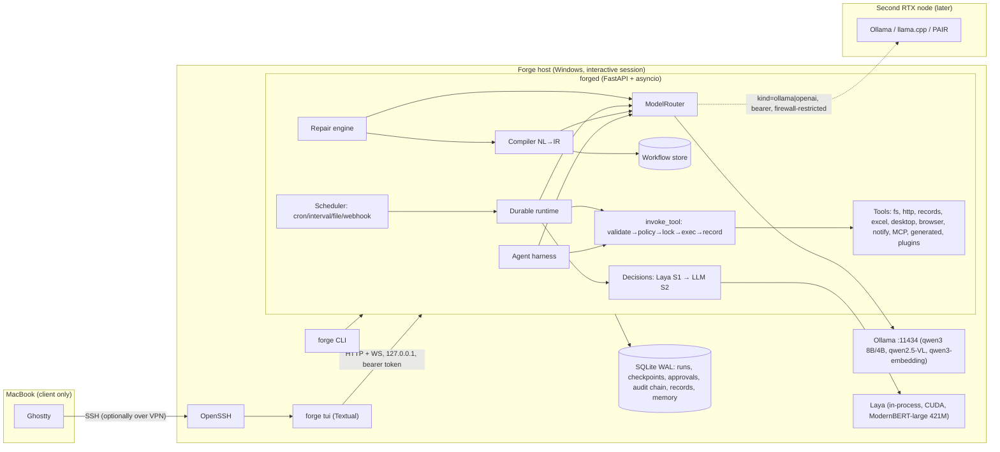
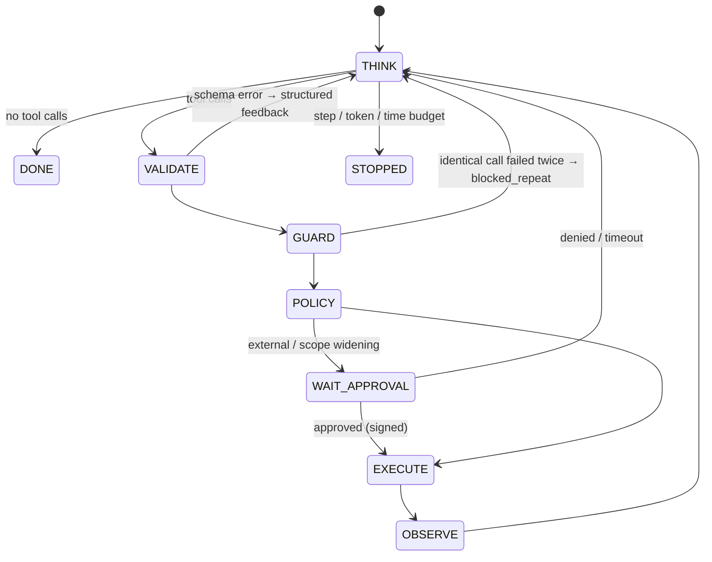
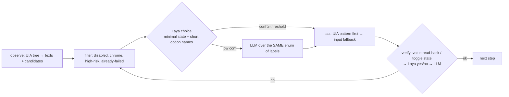

# Forge — System Architecture

> Covers spec documents 2 (System Architecture), 4 (Data & State), 5 (Automation Compiler), 6 (Desktop Control),
> 7 (Distributed Inference) and 8 (Security & Threat Model). Measured numbers are from the RTX 3070 Laptop (8 GB)
> on 2026-10-25 and are labelled **[measured]**; everything else is design.

## 1. Shape of the system

Forge is one long-lived Python process (`forged`) that owns all state in SQLite. Every user surface (TUI, CLI,
remote SSH sessions) is a client of it. Its central idea: **compile natural-language requests into typed,
versioned, tested workflows once, then run them deterministically.** Models are called only at explicit `llm`
and `decide` steps, and while a workflow is being built or repaired.

### Process and trust boundaries
| Boundary | Enforcement |
|---|---|
| Client → daemon | Bound to `127.0.0.1` only. Bearer token in `~/.forge/token`. Remote access means SSH into the host, so the API is never exposed. |
| Model output → actions | Every tool call is checked against a pydantic schema, then the default-deny policy, then approval for external effects. |
| Untrusted content (web, email, documents) → prompts | Labelled as untrusted in prompts. It cannot widen permissions, because grants are fixed at deploy time and repair can't edit them. |
| Workflow → host | Per-workflow `permissions` (tools, fs_read/fs_write roots, net hosts, desktop/browser/shell flags). Protected paths are always denied. |
| Generated code → host | Pure-compute only: AST allowlist, plus a `python -I` subprocess with stripped env, Job Object (512 MB, no child processes) and a 20 s timeout. |
| Approvals → DB | HMAC-SHA256 signature with a key in Windows Credential Manager. Each approval is bound to an action hash, expires, and actions are single-use. |
| Audit | Hash-chained table. `GET /audit` verifies the chain. |

## 2. Agent harness (`forge/agent/loop.py`)

- **Hallucinated arguments.** Arguments are validated against the tool's pydantic model before any policy check or execution. The model gets back `{error, errors[field,msg], schema}` instead of a crash.
- **Repeated failures.** Calls are keyed by `sha(tool, args)`. A third identical failing call is refused with `blocked_repeat`, which forces the model to re-plan.
- **Context.** The model sees the system prompt, memory labelled `FACT` / `OBSERVED` / `UNVERIFIED HYPOTHESIS`, and the most recent messages that fit. Old tool outputs are truncated first.
- **Dynamic tool exposure.** The model sees the core tools, plus `tools.search` hits for the request, plus tools already used in the session. That's about 15 tools rather than 46, which matters for an 8B model.
- **Parallelism.** Side-effect-free calls in one turn run concurrently. `agent.delegate` spawns subagents (their own session and budget) and they run in parallel.
- **Persistence.** Every message and tool call is in SQLite. A daemon crash marks the session `interrupted`, and the user continues it.

## 3. Workflow IR, compiler, runtime

**IR** (`forge/workflows/ir.py`, pydantic):
- Top level: `triggers`, `inputs`, `permissions`, `steps`, `outputs`, `tests`.
- Step kinds: `tool`, `llm` (JSON-schema constrained), `decide` (Laya choice/score/yes_no with LLM escalation), `set`, `approval`, `branch`, `foreach` (bounded, optional parallel), `parallel`.
- Values are sandboxed Jinja2. A whole-string `{{ expr }}` returns the native value.

**Compile pipeline** (`forge/workflows/compiler.py`):
1. The model writes IR JSON. Ollama JSON mode guarantees it parses.
2. pydantic validation, then `check_ir`. That catches unknown tools (with suggestions), missing or unknown arguments, concrete-argument type errors, references to steps that don't exist, tools used but not granted, missing capabilities, and invalid cron or Jinja syntax.
3. Structured issues go back to the model, up to 3 repair rounds.
4. A version is created, then the test scenarios run with mocks, offline. One repair round is allowed, but it may not delete the success assertion.
5. Dry-run: side-effecting tools are mocked, while **all grants are still enforced**.
6. A signed deploy approval is requested. It shows the permission diff against the deployed version and any advisory expectation failures.

**Runtime** (`forge/runtime/engine.py`):
- Runs are claimed with a lease and heartbeat.
- A checkpoint row is written per step path (`assess[3].fit`). Succeeded steps are replayed from storage, never re-executed.
- A step left `running` after a crash is re-executed, unless it's an external-effect tool without an idempotency key. Then the run stops in `waiting_user` ("did this already happen?").
- Retries happen only for `transient` and `resource_unavailable` failures, with exponential backoff.
- Dedupe keys are enforced by a UNIQUE constraint. The scheduler persists `next_fire_at` and uses a dedupe key per fire time, so a restart can't skip or double-fire. There's a 6-hour misfire grace window.

**Failure taxonomy** (`forge/errors.py`):

| class | retry | repair |
|---|---|---|
| transient | auto, with backoff | no |
| resource_unavailable | auto, deferred | no |
| invalid_input | no | yes |
| interface_changed | no | yes |
| defect | no | yes |
| permission_denied | no | no (report to user) |
| missing_credential | no | no (report to user) |
| needs_user | no | no (report to user) |
| needs_approval | no | no (wait for user) |

**Repair** (`forge/runtime/repair.py`):
1. Diagnose: the failed step, its error, the same step's output on the last successful run, and recent tool calls.
2. The model proposes a full patched IR. It is rejected if `permissions` or `id` changed.
3. The patch goes through check_ir, tests and dry-run, then a deploy approval.
4. A repaired version that fails within its first 3 runs is rolled back automatically to its parent.
5. At most one proposal per workflow per hour.

## 4. Data and state (`forge/schema.sql`)
- **Workflows:** `workflows`, `workflow_versions` (status: draft → deployed → retired/rejected; created_by user/compiler/repair; parent link).
- **Execution:** `schedules`, `runs`, `step_runs`, `tool_calls`.
- **Chat:** `sessions`, `messages`.
- **Security:** `approvals` (signed, single-use), `grants`, `audit` (hash chain).
- **Memory:** `memories` (kind + provenance + float32 embedding).
- **Records:** `records`, `record_events`, `excel_exports`, `record_conflicts`.

**Versioning.** Each IR version has a content hash. A deploy approval is bound to (version_id, ir_hash, permissions), and activation re-checks the hash.

**Records and Excel.**
- Collections are declared by plugins: typed fields, enums, min/max, key fields that form a stable ID, and status transitions. Every field change is a `record_events` row.
- **SQLite is the source of truth.** Excel is an exported view: a formatted Table, enum data-validation, conditional formatting, a Statistics sheet with live COUNTIF formulas and a chart, an Activity Log, and hidden `_row_hash`.
- Writes are atomic: temp file → re-open → verify IDs → `os.replace`, with a backup first.
- **Import is a three-way merge** against the export snapshot. An edit made only in Excel is validated and applied. An edit made in both places becomes a `record_conflicts` row; the DB is never overwritten silently.
- An open file (`~$` lock) is reported as `resource_unavailable`.
- openpyxl drops charts and images from arbitrary workbooks it re-saves, so `excel.write_cells` routes such workbooks through private Excel COM (`DispatchEx`).

**Memory.**
- Provenance gates use: only `user` and `verified` memories are injected as facts. Agent-written memories are stored as `generated` and injected as hypotheses.
- Retrieval: brute-force cosine over local qwen3-embedding vectors, dedupe at cos > 0.95, falling back to lexical search when the GPU node is down.
- Skills are workflows and procedures, not fine-tuning.

## 5. Desktop control (`forge/desktop/*`)

- **Observation API:** `observe(title_re) -> Observation{window, windows, texts, candidates[ActionCandidate], digest, observe_ms, screenshot?}`.
- **ActionCandidate:** `{id, label, action: click|type|select|toggle|expand|focus, control_type, name, automation_id, rect, value, parent, risk, selector: Selector{window, control_type, name, automation_id, index}}`.
- **Executor:** `act(candidate|selector, action, text)`. It uses UIA Invoke/Value/Toggle/Select/ExpandCollapse first, which **doesn't move the user's mouse or take focus**. It falls back to `click_input`/`type_keys`, reported as `method="input"`. Also available: hotkeys, file dialog, clipboard, scroll, drag, screenshot, and a vision fallback (`desktop.vision`, qwen2.5-VL).
- **Three execution modes:** deterministic selector replay for compiled workflows; `DesktopAgent.do_step` (Laya + escalation) for exploration; and `replay()`, which is deterministic but **self-heals with Laya when a stored selector no longer resolves**.

**Laya findings [measured]:**
- Putting the full control list in Laya's *state* dropped Calculator action-selection from **7/8 to 0/8**. Laya scores the state against each option, so the state must be just the goal or step, and options must be short names.
- The lexical pre-ranker needed digit↔word normalisation ("7" ↔ "Seven"). Without it, the correct button was cut before Laya ever saw it.
- Raw confidences are over-confident when the right option is missing (it scored 1.0 on a wrong pick). This is why the candidate set has to be grounded and complete.
- Verifying typed values needs deterministic read-back. A model check alone rejected a correct field entry, and the retry overwrote a different field.

**Windows session facts:**
- UIA needs an interactive, unlocked desktop, and a Session 0 service can't drive it. So forged runs as a **logon task** (`forge install-startup`), not a service.
- GUI steps defer while the screen is locked or a UAC secure desktop is up (UAC is `needs_user`; Forge never runs elevated).
- Unattended GUI steps also defer until the user has been idle for 120 s. One desktop lease means one GUI task at a time.
- Per-monitor DPI awareness is set, so rectangles are in physical pixels.
- True unattended parallel GUI work needs a second session (a Hyper-V VM, or another Windows user over RDP). That's phase 2.

## 6. Inference (`forge/models/*`)

| Capability | Model | Measured |
|---|---|---|
| reasoning, tool calling, compile, desktop_reasoning | `qwen3:8b` Q4_K_M, ctx 8192 | 5.5 GB VRAM, 56 tok/s, native Ollama tool calls ✓ **[measured]** |
| fast / fallback | `qwen3:4b` | 2.5 GB on disk |
| vision | `qwen2.5vl:7b` | on demand; swaps the 8B out (`OLLAMA_MAX_LOADED_MODELS=1`) |
| embeddings | `qwen3-embedding:0.6b` | |
| System 1 decisions | Laya `convaiinnovations/laya` (ModernBERT-large 421M) | ~1.6 GB; 45 ms per decision warm; 39 s cold load **[measured]** |

8B + Laya + 8k KV (q8_0) = **7.9 / 8.2 GB [measured]**. It fits, with no room for the VL model at the same time.

**The router** (`ModelRouter.generate(capability, messages, tools=, schema=, complexity=)`):
- Ranks candidate (model, node) pairs. The score is quality, minus a swap penalty if the model isn't resident (avoiding 5–10 s reloads), minus queue depth × 0.75. Context that doesn't fit and unhealthy nodes are hard-excluded.
- Per-node concurrency semaphores. Health is probed every 15 s. A circuit breaker opens after 3 failures for 60 s, and the request falls back to the next candidate.
- `/model <cap> <model>` pins a model from the TUI.
- Nodes are `kind=ollama` (native API: `think`, `format`, `num_ctx`) or `kind=openai` (llama.cpp server, LM Studio, **NVIDIA PAIR**), with a per-node bearer token.
- **Adding the 3060 desktop is a `[[nodes]]` entry.** Bind its Ollama to the LAN or VPN IP and firewall it to the Forge host only. GPUs are never pooled: PAIR also routes per request and does not combine VRAM [verified from NVIDIA docs].

## 7. Browser (`forge/browser/*`)
- Playwright Chromium with a persistent profile per name. Logins are user-assisted (`headless=false`), and Forge never handles passwords.
- Browser windows are visible by default, with a decorative Forge cursor, target highlights, and click pulses.
  `browser.headless`, `browser.show_cursor`, and `browser.action_delay_ms` (default 300, range 0–2000) require restart.
  Explicit workflow `headless` overrides remain supported; conflicting launch modes on an open profile raise
  `needs_user` without closing the existing session. The overlay never sends Windows input or enters extracted page text.
- `snapshot` returns tagged interactive elements (role, accessible name, value) plus page text. `browser.find` uses Laya, with the LLM as fallback.
- `browser.act` refuses submit/send/apply/buy/delete-looking controls. `browser.submit` is `external`, so it always needs approval.
- CAPTCHA, Turnstile and "verify you are human" pages raise `needs_user`. **No bypass.**
- Workflow navigation outside `permissions.net` is aborted at the network layer. JS dialogs are recorded: alerts accepted, confirms dismissed.
- `http.get` honours robots.txt, and redirects to non-allowlisted hosts are refused.

## 8. Threat model (summary)

| Threat | Mitigation | Residual risk |
|---|---|---|
| Prompt injection via web, email or documents | Untrusted-content labelling. Permissions are fixed at deploy. External actions need a signed approval for the exact arguments. Repair can't change permissions. | An injected page can still make an *approved-scope* workflow do wrong-but-permitted things, such as writing bad data inside its own folder. Approvals show exact arguments to limit this. |
| Model misuses tools | Default-deny; pydantic arguments; path and host checks; protected paths; side-effect levels; repeat-failure guard. | Tools inside the grant can be combined in unexpected ways. |
| Approval forgery or bypass | HMAC with a keyring key; action-hash binding; expiry; single-use; audit hash chain. | A process running as the same Windows user can read the keyring. Forge's guarantees stop at the user account boundary. |
| Generated code | Pure-compute AST allowlist, isolated subprocess, Job Object, timeout, approval with the code hash, on-disk hash re-check. | The AST filter isn't a sandbox. Phase 2: Windows Sandbox or an AppContainer with no network. |
| Plugins and MCP servers | MCP tools default to approval-gated; plugins are subject to the policy engine. | Plugin Python runs in-process with Forge's privileges: install only plugins you trust. |
| Network exposure | Loopback-only API, SSH for remote access, token auth, nodes firewalled. | A compromised Mac SSH key gives full control. Use a hardware-backed key. |
| Runaway automation | Emergency stop (`forge stop`, Ctrl+X twice in the TUI) checked before every step and tool call; budgets; leases. | An action already running finishes its current UIA call. |
| Data loss in Excel | Backups, atomic writes, verification, three-way merge, conflicts table. | Edits made while Forge exports between the lock check and the write: small window. |
